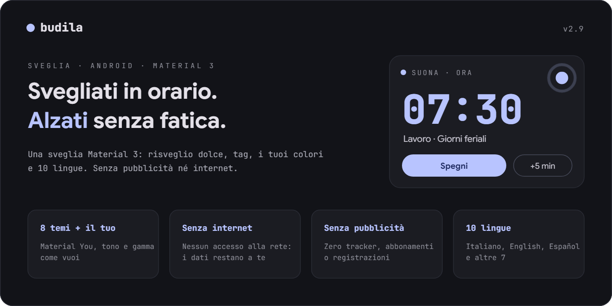
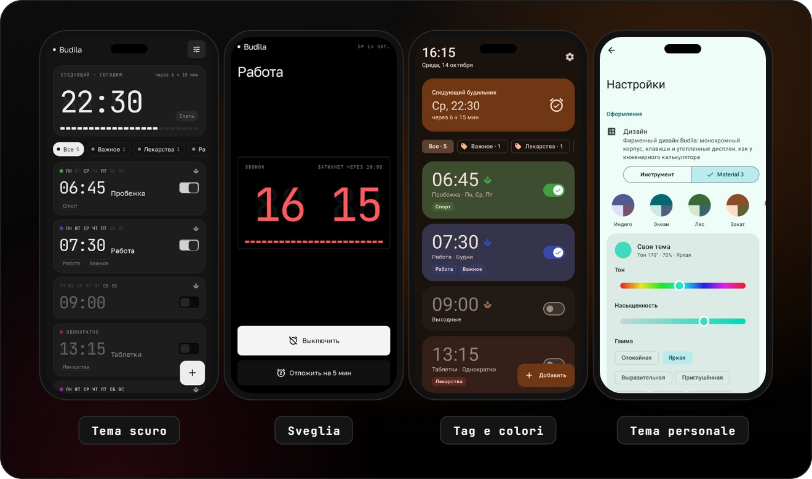
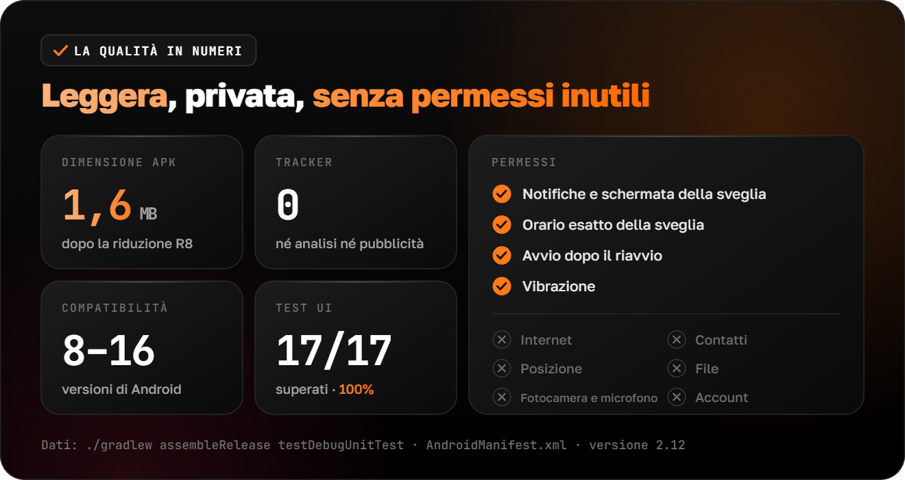

[Русский](README.ru.md) · [English](README.md) · [Español](README.es.md) · [Português](README.pt.md) · [Deutsch](README.de.md) · [Français](README.fr.md) · **Italiano** · [Türkçe](README.tr.md) · [Українська](README.uk.md) · [Polski](README.pl.md)

 

<picture><source srcset="assets/readme/hero-it.svg"></picture>

&nbsp;&nbsp;

**Budila è una sveglia per Android che ti sveglia in orario, senza stress.** Risveglio dolce, tag e colori, il design esclusivo «Strumento» e 8 temi Material You. Nessun accesso a internet, niente pubblicità né tracker.

 

<picture><source srcset="assets/readme/screens-it.svg"></picture>

 

<picture><source srcset="assets/readme/features-it.svg"></picture>

<b>Di più sulle funzioni</b>

### ⏰ Schermata principale

In alto, in grande, l’ora e la data di oggi: «martedì 6 ottobre». Sotto c’è la scheda **«Prossima sveglia»**: il giorno, l’ora e quanto manca. Le sveglie si possono colorare con uno dei 10 colori e contrassegnare con dei **tag**: una fila di filtri («Tutte · 5», «Lavoro · 2») mostra solo quelle che servono.

### ✏️ Editor

L’ora si imposta sul **quadrante Material 3** o con la tastiera. Nome, ripetizione nei giorni della settimana, tag (già pronti o tuoi), colore della scheda, vibrazione e **risveglio dolce**. Una sveglia eliminata si recupera con un solo tocco.

### 🌿 Risveglio dolce

La sveglia parte quasi in silenzio, il volume sale gradualmente per circa un minuto e la vibrazione si attiva dopo 30 secondi. La modalità si attiva e disattiva **per ogni sveglia separatamente**; nelle impostazioni scegli come sarà per le nuove.

### 🔔 Sveglia che suona

La schermata della sveglia accende il display da sola e si apre **sopra la schermata di blocco**. **«Spegni»** e **«Posticipa»** (da 5 a 20 minuti) sono sullo schermo e nella notifica. Se nessuno risponde, la sveglia si zittisce da sola dopo 5–30 minuti.

### 🧮 Design «Strumento»

Il design di Budila nello stile di [Okto](https://github.com/sailxx/Okto): scocca monocromatica, tasti veri e display incassati, come una calcolatrice scientifica. Le cifre sono in JetBrains Mono con gli otto «spenti» e un autotest all’avvio, l’ora si digita su un tastierino e la sveglia che suona si illumina di rosso. 9 temi: Classico (chiaro, scuro, OLED), Carta, Menta, Sakura, Mezzanotte, Oceano, Nord, Cremisi, Ambra. È attivo di default; nelle impostazioni si può tornare a Material 3.

### 🎨 Temi

8 temi: **Material You** dallo sfondo, Indaco, Oceano, Foresta, Tramonto, Sakura, Grafite e **Personale**: scegli la tonalità sulla ruota dei colori, la saturazione e la gamma (Calma, Vivace, Espressiva, Arcobaleno…). Chiaro, scuro o come il sistema, più uno sfondo nero puro per AMOLED.

### 🌍 10 lingue

Русский, English, Українська, Español, Português, Deutsch, Français, Italiano, Türkçe, Polski. Su Android 13+ la lingua di Budila si può scegliere separatamente da quella di sistema.

### 🛡 Affidabilità

Le sveglie passano per l’`AlarmClock` di sistema e suonano puntuali anche quando il telefono è in standby. Dopo un riavvio o un cambio di ora o di fuso orario, Budila le reimposta.

 

<picture><source srcset="assets/readme/quality-it.svg"></picture>

<b>Installazione</b>

1. Scarica [**Budila.apk**](https://github.com/sailxx/Budila/releases/latest/download/Budila.apk) sul telefono.
2. Apri il file e consenti l’installazione da questa origine.
3. Al primo avvio consenti le notifiche: senza di esse la schermata della sveglia non compare.

Serve Android 8.0 o successivo. Non servono Google Play né account.

Budila è anche su [Komi Store](https://github.com/komi-store/komi-store), uno store di app basato sulle release di GitHub: cerca «Budila» e Komi Store ti proporrà gli aggiornamenti da solo.

<b>Privacy e sicurezza</b>

Budila **non ha accesso a internet**: nel manifest non c’è il permesso `INTERNET`. Le sveglie restano solo sul telefono e non finiscono nei backup sul cloud. Niente pubblicità, analisi o tracker. Dettagli e come segnalare una vulnerabilità sono in [SECURITY.md](SECURITY.md).

