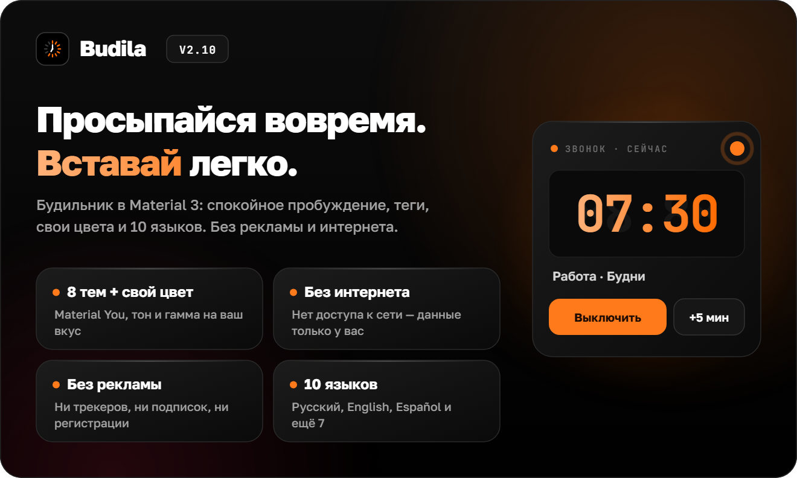
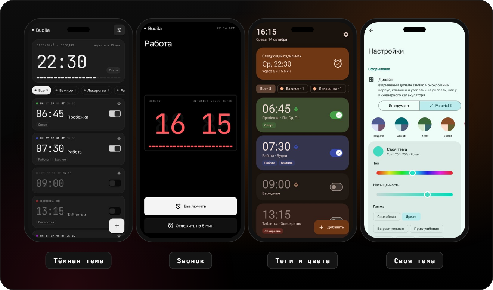
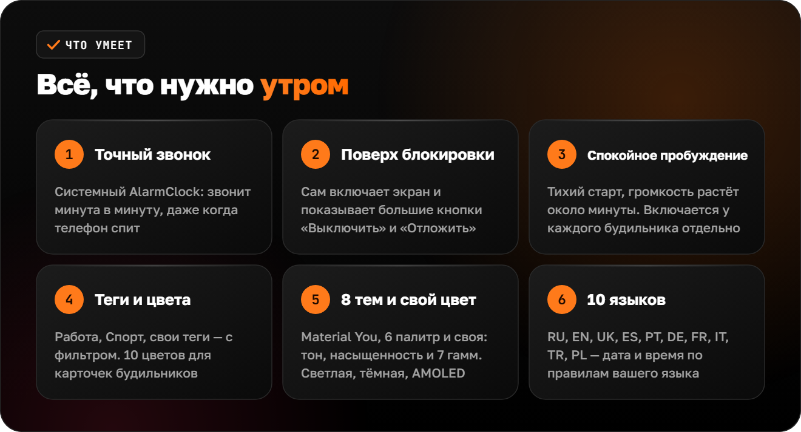
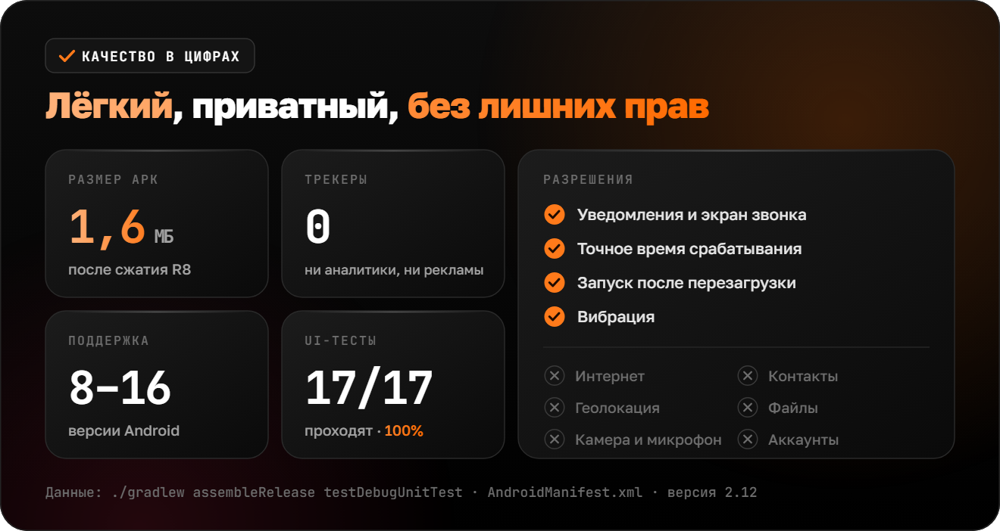

**Русский** · [English](README.en.md) · [Español](README.es.md) · [Português](README.pt.md) · [Deutsch](README.de.md) · [Français](README.fr.md) · [Italiano](README.it.md) · [Türkçe](README.tr.md) · [Українська](README.uk.md) · [Polski](README.pl.md)

 

<picture><source srcset="assets/readme/hero-ru.svg"></picture>

&nbsp;&nbsp;

**Budila — будильник для Android, который будит вовремя и без стресса.** Спокойное пробуждение, теги и цвета, фирменный дизайн «Инструмент» и 8 тем Material You. Работает без интернета, без рекламы и трекеров.

 

<picture><source srcset="assets/readme/screens-ru.svg"></picture>

 

<picture><source srcset="assets/readme/features-ru.svg"></picture>

<b>Подробнее о возможностях</b>

### ⏰ Главный экран

Вверху крупно текущее время и дата — «Вторник, 6 октября». Ниже карточка **«Следующий будильник»**: день, время и сколько осталось. Будильники можно окрасить в любой из 10 цветов и пометить **тегами** — ряд фильтров («Все · 5», «Работа · 2») показывает только нужные.

### ✏️ Редактор

Время — на **циферблате Material 3** или с клавиатуры. Название, повтор по дням недели, теги (готовые или свои), цвет карточки, вибрация и **спокойное пробуждение**. Удалённый будильник можно вернуть одной кнопкой.

### 🌿 Спокойное пробуждение

Звонок начинается почти беззвучно, громкость плавно растёт около минуты, вибрация включается через 30 секунд. Режим включается и выключается **у каждого будильника отдельно**; в настройках задаётся, каким он будет у новых.

### 🔔 Звонок

Экран звонка сам включает дисплей и открывается **поверх экрана блокировки**. **«Выключить»** и **«Отложить»** (на 5–20 минут) — на экране и в уведомлении. Если никто не ответит, звонок затихнет сам через 5–30 минут.

### 🧮 Дизайн «Инструмент»

Фирменный дизайн Budila в стиле [Okto](https://github.com/sailxx/Okto): монохромный корпус, настоящие клавиши и утопленные дисплеи, как у инженерного калькулятора. Цифры — JetBrains Mono с «незажжёнными» восьмёрками и самотестом при запуске, время набирается на клавиатуре, а звонящий будильник горит красным. 9 тем — Классика (светлая, тёмная, OLED), Бумага, Мята, Сакура, Полночь, Океан, Норд, Кармин, Янтарь. Включён по умолчанию; в настройках можно вернуть Material 3.

### 🎨 Темы

8 тем: **Material You** из обоев, Индиго, Океан, Лес, Закат, Сакура, Графит и **своя** — выберите тон на цветовом круге, насыщенность и гамму (Спокойная, Яркая, Выразительная, Радуга…). Светлая, тёмная или как в системе, плюс чистый чёрный фон для AMOLED.

### 🌍 10 языков

Русский, English, Українська, Español, Português, Deutsch, Français, Italiano, Türkçe, Polski. На Android 13+ язык Budila можно выбрать отдельно от системы.

### 🛡 Надёжность

Будильники ставятся через системный `AlarmClock` и звонят точно, даже когда телефон спит. После перезагрузки, смены времени или часового пояса Budila расставит их заново.

 

<picture><source srcset="assets/readme/quality-ru.svg"></picture>

<b>Установка</b>

1. Скачайте [**Budila.apk**](https://github.com/sailxx/Budila/releases/latest/download/Budila.apk) на телефон.
2. Откройте файл и разрешите установку из этого источника.
3. При первом запуске разрешите уведомления — без них не появится экран звонка.

Нужен Android 8.0 или новее. Google Play и аккаунты не нужны.

Budila есть и в [Komi Store](https://github.com/komi-store/komi-store) — магазине приложений из GitHub-релизов: найдите «Budila» в поиске, и Komi Store будет сам предлагать обновления.

<b>Приватность и безопасность</b>

У Budila **нет доступа к интернету**: в манифесте нет разрешения `INTERNET`. Будильники хранятся только на телефоне и не попадают в облачные бэкапы. Нет рекламы, аналитики и трекеров. Подробности и как сообщить об уязвимости — в [SECURITY.md](SECURITY.md).

